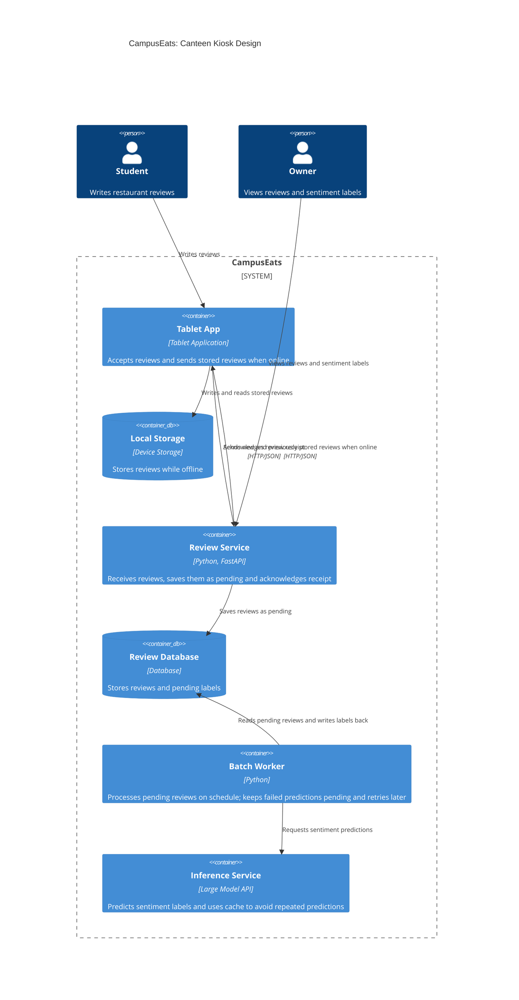

# Task 4: Deployment topologies and trade-offs

**Name / ชื่อ:**รวิกานต์ ฉายากุล

**Student ID / รหัสนิสิต:**6630283021

This is **individual work**: each student completes and submits their own copy, in their own fork.

*งานนี้เป็น**งานเดี่ยว** นิสิตแต่ละคนทำและส่งงานของตัวเอง ใน fork ของตัวเอง*

**Scenario (A, B or C) / Scenario ที่เลือก:** B

Choose **one** scenario below. If the last digit of your student ID is odd, take A or B; if it is even, take B or C. Use your measurements from Tutorial 6 as evidence: cite run names from `results/runs.csv`. Answer in Thai or English.

เลือก scenario **หนึ่ง** ข้อด้านล่าง ถ้าเลขตัวสุดท้ายของรหัสนิสิตเป็นเลขคี่ ให้เลือก A หรือ B ถ้าเป็นเลขคู่ ให้เลือก B หรือ C ใช้ผลการวัดจาก tutorial ที่ทำไปเป็นข้อมูลอ้างอิง โดยอ้างชื่อ run จาก `results/runs.csv` จะตอบเป็นภาษาไทยหรือภาษาอังกฤษก็ได้

Facts that hold in every scenario / ข้อเท็จจริงที่ใช้กับทุก scenario:

- The large model serves at most **20 calls per second** (4 calls at once × about 200 ms each), and every call costs money.

  *large model รับได้สูงสุด **20 calls ต่อวินาที** (พร้อมกัน 4 calls × ประมาณ 200 ms ต่อ call) และทุก call มีค่าใช้จ่าย*
- The small model is fast and cheap enough to run anywhere, including inside the review service or on a kiosk, but it is much less accurate on its own.

  *small model เร็วและถูกพอที่จะรันที่ไหนก็ได้ รวมถึงภายใน review service หรือบน kiosk แต่ถ้าใช้ตัวเดียวจะแม่นน้อยกว่ามาก*

## Scenarios

**A. Owner alerts.** When a customer posts a negative review, the restaurant owner gets a push notification within **2 seconds**. At the lunch peak, CampusEats receives **40 reviews per second**. A missed alert is acceptable, but a wrong alert (for example, "your customer is unhappy" when they are happy) makes owners stop trusting alerts and, in the end, ignore them.

*เมื่อลูกค้าโพสต์รีวิวเชิงลบ เจ้าของร้านจะต้องได้รับ push notification ภายใน **2 วินาที** เวลาช่วงพีคตอนเที่ยง CampusEats ได้รับรีวิวจำนวน **40 รายการต่อวินาที** การพลาด alert ไปบ้างนั้นยอมรับได้ แต่ alert ที่ผิด (เช่น "ลูกค้าไม่พอใจ" ทั้งที่จริงๆ แล้วพอใจ) จะทำให้เจ้าของร้านไม่เชื่อถือและเลิกสนใจ alert ในที่สุด*

**B. Canteen kiosk.** A tablet in each canteen lets students leave a review on the spot. However, the canteen Wi-Fi is poor: the tablets lose their connection several times a day, for minutes at a time. The system must accept every review, even while a tablet is offline. Restaurant owners need the labels **by the end of the day**.

*มี tablet ในแต่ละโรงอาหารให้นิสิตรีวิวได้ทันที อย่างไรก็ดี การเชื่อมต่อ Wi-Fi ในโรงอาหารไม่ดี ทำให้ tablet หลุดการเชื่อมต่อวันละหลายครั้ง ครั้งละหลายนาที ระบบจะต้องรับรีวิวได้ทุกรายการแม้ขณะที่กำลัง offline อยู่ และเจ้าของร้านต้องการ label **ภายในสิ้นวัน***

**C. Weekly report.** Restaurant owners want a weekly sentiment report. Nothing in producing this report has to be real-time. **Accuracy matters most** and **cost must be minimal**.

*เจ้าของร้านต้องการรายงาน sentiment รายสัปดาห์ ไม่มีอะไรที่จะต้องทำแบบ real-time ในการออกรายงานนี้ ความแม่นยำ **(accuracy) สำคัญที่สุด** และ **ค่าใช้จ่ายต้องน้อยที่สุด***

## Topologies and patterns to choose from / Topology และ pattern ที่เลือกใช้ได้

| | Topology | Where the model runs / โมเดลรันที่ไหน |
|---|---|---|
| T1 | Model as a service, synchronous | Inference service, called for each review (today's baseline) *inference service ถูกเรียกทุกรีวิว (baseline ของวันนี้)* |
| T2 | Model as a library | Inside the review service, or on the device *ภายใน review service หรือบนอุปกรณ์* |
| T3 | Hybrid | Small model locally, large model as a remote service *small model รันในเครื่อง large model เป็น remote service* |
| T4 | Asynchronous / batch | Reviews are queued (broker, W10) or stored, and scored later in bulk *รีวิวถูกเข้าคิว (broker, W10) หรือเก็บไว้ แล้วติด label ทีหลังเป็นชุด* |

Combine one topology with any of the patterns from Tutorial 6: **fallback**, **cascade** and **cache**.

*เลือก topology หนึ่งแบบ แล้วผสมกับ pattern จาก Tutorial 6 ได้ตามต้องการ: **fallback**, **cascade** และ **cache***

## 1. Quality requirements

The three most important quality requirements for your scenario, each with a number where possible.

*quality requirements ที่สำคัญที่สุด 3 ข้อของ scenario ที่เลือก ระบุตัวเลขเมื่อทำได้*

| # | Quality | Requirement |
|---|---|---|
| 1 | Availability | รีวิว 100% ต้องถูกบันทึก แม้ tablet offline นานหลายนาที |
| 2 | Performance / Timeliness | รีวิวต้องถูกติด label ภายในสิ้นวัน|
| 3 |Accuracy | label ถูกต้องอย่างน้อย 90% ของรีวิวที่ได้ label |

## 2. Design / การออกแบบ

Your topology, the patterns you add, and a container-level diagram (C4 level 2). The C4 diagram must be written in Mermaid.

*topology ที่เลือก pattern ที่เพิ่ม และ diagram ระดับ container (C4 level 2) เขียนด้วย Mermaid*
topology: T4 Asynchronous / batch 

เลือกใช้ T4 เพราะระบบไม่จำเป็นต้องติด Label ให้รีวิวทันที โดย Tablet จะเก็บรีวิวไว้ในเครื่องเมื่อ Offline (Store-and-forward) และเมื่อกลับมา Online จะส่งรีวิวที่ค้างอยู่ไปยัง Server จากนั้น Review Service จะบันทึกรีวิวลง Database ในสถานะ Pending และตอบกลับ Tablet ว่าได้รับรีวิวแล้ว โดยไม่ต้องเรียก Model ในขั้นตอนนี้

เมื่อถึงเวลาที่กำหนด Batch Worker จะนำรีวิวที่อยู่ในสถานะ Pending มาติด Label ด้วย Large Model หากเรียก Large Model แล้วเกิด Error หรือ Timeout จะคงรีวิวนั้นไว้ในสถานะ Pending และลองประมวลผลใหม่ในรอบถัดไป เพื่อไม่ให้รีวิวสูญหาย

เหตุผลที่เลือก Cache: เพราะรีวิวบางส่วนอาจมีข้อความซ้ำกัน เช่น คำตอบสั้น ๆ อย่าง "Delicious!" ซึ่ง Cache จะ Hit เมื่อข้อความเหมือนกันทุกตัวอักษร (ยกเว้นความแตกต่างของตัวพิมพ์เล็ก/ใหญ่และช่องว่าง) ทำให้สามารถนำผล Prediction เดิมกลับมาใช้ได้โดยไม่ต้องเรียก Large Model ใหม่ ช่วยลดจำนวน Large Model Calls และประหยัดค่าใช้จ่าย โดยผลทดลอง t4-large-cache มี Cache Hits 34% และใช้ Large Model Calls 66% โดยยังได้ Accuracy 93.5% เท่ากับการใช้ Large Model โดยไม่มี Cache (t0-large)

เหตุผลที่ไม่เลือก Cascade: แม้ Cascade จะช่วยลดจำนวนการเรียก Large Model แต่ก็ทำให้ Accuracy ลดลง เช่น t3-cache ได้ Accuracy 93.0% และใช้ Large Model Calls 38% ขณะที่ Design ของเราใน t4-large-cache ได้ Accuracy 93.5% และใช้ Large Model Calls 66% เนื่องจาก Scenario B มีเวลาจนถึงสิ้นวันในการติด Label จึงไม่จำเป็นต้องรีบลดเวลาในการประมวลผล และยอมจ่ายค่า Large Model เพิ่มเพื่อรักษา Accuracy ให้สูงกว่า

## 3. Evidence / หลักฐาน

Which runs support your choice? Show the numbers and, for scenario A, the capacity arithmetic: how many large-model calls per second does your design need at the peak?

*run ไหนที่สนับสนุนการตัดสินใจของนิสิต ให้นิสิตแสดงตัวเลขประกอบ และสำหรับ scenario A ให้นิสิตแสดงการคำนวณ capacity ด้วย เพื่อแสดงว่าในช่วงพีคนั้น design ของนิสิตต้องใช้ large model กี่ calls ต่อวินาที*

| Run | What it shows / แสดงอะไร |
|---|---|
| t0-small | Small Model มี Accuracy เพียง 72.5% ซึ่งต่ำกว่า Requirement 90% จึงไม่เลือก T2 |
| t1-after | หลังใช้ Fallback มี Errors ลดลงจาก 22 เหลือ 0 และมี Pending 25 รายการ แสดงว่าสามารถเก็บรีวิวไว้ติด Label ภายหลังได้ |
| t4-large-cache | Design ของเราได้ Accuracy 93.5%, Errors 0, Large Calls ลดเหลือ 66% และ Cache Hits 34% แสดงว่า Cache ช่วยลดการเรียก Large Model และค่าใช้จ่ายโดยไม่ลด Accuracy |

## 4. ADR

Use the ADR format from W5.

*ใช้รูปแบบ ADR จาก W5*

**Title:** เลือกใช้ T4 Asynchronous / Batch สำหรับ Canteen Kiosk

**Status:** Proposed

**Context:** ระบบ Canteen Kiosk มีปัญหา Wi-Fi ไม่เสถียร ทำให้ Tablet สามารถขาดการเชื่อมต่อหลายครั้งต่อวัน ครั้งละหลายนาที ระบบจึงต้องสามารถรับรีวิวได้ทุกครั้ง แม้ในขณะที่ Offline และเจ้าของร้านต้องได้รับ Sentiment Label ภายในสิ้นวัน โดยมี Quality Requirements ที่สำคัญ 3 ข้อ ได้แก่

- Availability: Tablet ต้องรับและบันทึกรีวิวได้ 100% แม้ไม่มีอินเทอร์เน็ต และต้องไม่ทำให้รีวิวสูญหาย โดยส่งขึ้น Server เมื่อกลับมา Online
- Timeliness: รีวิวทุกรีวิวต้องได้รับ Sentiment Label ภายในสิ้นวัน
- Accuracy: ต้องมี Accuracy อย่างน้อย 90%

**Decision:** เลือกใช้ T4: Asynchronous / Batch ร่วมกับ Store-and-forward, Fallback และ Cache

- Tablet จะเก็บรีวิวไว้ใน Local Storage เมื่อ Offline และส่งไปยัง Server เมื่อกลับมา Online
- Review Service จะบันทึกรีวิวลง Database ในสถานะ Pending และตอบกลับว่าได้รับรีวิวแล้ว โดยไม่ต้องรอ Model
- Batch Worker จะนำรีวิว Pending มาติด Label ด้วย Large Model ตามตารางเวลาที่กำหนด
- หาก Large Model เกิด Error หรือ Timeout จะคงรีวิวไว้ในสถานะ Pending และลองประมวลผลใหม่ในรอบถัดไป เพื่อไม่ให้รีวิวสูญหาย
- ใช้ Cache เพื่อหลีกเลี่ยงการเรียก Large Model ซ้ำเมื่อข้อความเหมือนกัน
- ไม่เลือก Cascade เพราะต้องการรักษา Accuracy ให้สูงที่สุด แม้ต้องเรียก Large Model มากขึ้น

**Consequences:**
- Positive:
  - Tablet สามารถรับและเก็บรีวิวได้แม้ไม่มีอินเทอร์เน็ต ด้วย Store-and-forward
  - การรับรีวิวไม่ขึ้นกับความพร้อมของ Large Model เพราะ Review Service บันทึกรีวิวเป็น Pending ก่อน
  - ได้ Accuracy 93.5% จาก t4-large-cache เท่ากับ t0-large
  - Cache ช่วยลด Large Model Calls จาก 100% เหลือ 66% และมี Cache Hits 34% ทำให้ประหยัดค่าใช้จ่ายโดยไม่ลด Accuracy
- Negative:
  - เจ้าของร้านไม่สามารถเห็น  Label ได้ทันที ต้องรอ Batch Worker ประมวลผลตามตารางเวลา และอาจต้องรอจนถึงรอบถัดไปหาก Large Model เกิด Error หรือ Timeout
  - การไม่ใช้ Cascade ทำให้ต้องเรียก Large Model 66% เทียบกับ 38% เมื่อใช้ Cascade ร่วมกับ Cache (t3-cache) จึงมีค่าใช้จ่ายด้าน Large Model Calls มากกว่า 28 percentage points เพื่อแลกกับ Accuracy ที่เพิ่มจาก 93.0% เป็น 93.5%
  - Tablet ต้องเก็บรีวิวไว้ใน Local Storage ขณะที่ Offline หาก Tablet เสียหายหรือข้อมูลในเครื่องสูญหายก่อนส่งขึ้น Server รีวิวเหล่านั้นอาจสูญหายได้ จึงควรมีการสำรองข้อมูลหรือป้องกันข้อมูลในเครื่อง
  - ระบบต้องมี Batch Worker และกลไก Retry เพื่อจัดการรีวิวที่ยังอยู่ในสถานะ Pending

**Alternatives considered:** at least one topology you rejected, and why.

*อย่างน้อยหนึ่ง topology ที่ไม่เลือก และเหตุผล*

> - T1: Model as a service, synchronous — ไม่เลือก เพราะต้องพึ่งพาการเชื่อมต่ออินเทอร์เน็ตในการส่งรีวิวและเรียก Model หาก Wi-Fi หลุด Tablet จะไม่สามารถส่งรีวิวไปประมวลผลได้ทันที ซึ่งไม่ตรงกับ Requirement ที่ต้องรับรีวิวทุกครั้งแม้ Offline
> - T2: Model as a library — ไม่เลือก เพราะ Small Model เพียงอย่างเดียวมี Accuracy 72.5% จาก t0-small ซึ่งต่ำกว่า Requirement 90% และต่ำกว่า Large Model ที่ได้ Accuracy 93.5% จาก t0-large
> - T3: Hybrid — ไม่เลือก เพราะการใช้ Small Model ในเครื่องร่วมกับ Large Model แบบ Remote ไม่จำเป็นสำหรับระบบนี้ เนื่องจากไม่ต้องการผลลัพธ์แบบ Real-time และมีเวลาจนถึงสิ้นวันสำหรับการติด Label จึงเลือก T4 ที่สามารถรวบรวมรีวิวไว้แล้วประมวลผลเป็นชุดได้
